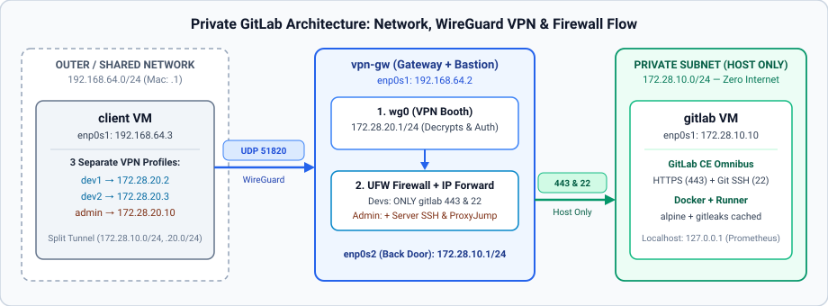

# Private Self-Hosted GitLab over WireGuard VPN

A scaled-down, private self-hosted GitLab CE setup running on isolated local VMs (UTM / QEMU on Apple Silicon) where `gitlab` sits on an internet-isolated private subnet reachable only through a WireGuard VPN gateway (`vpn-gw`).

[Video Walkthrough & Demo Explanation](https://drive.google.com/file/d/1PS0r06fCJqIOedKuHD5X_1IVEp05eHYV/view)
---

## Repository Contents

| File / Folder | Purpose |
| :--- | :--- |
| `README.md` | Architecture overview, design choices, and zero-to-working rebuild steps |
| `diagram-architecture.svg` | End-to-end network, VPN, and firewall flow diagram |
| `diagram-utm-networking.svg` | UTM virtual NICs, cables, and switch isolation diagram |
| `SECURITY.md` | Part 4 written answers (SSH tunnel vs. VPN + hanging SSH `git clone` checklist) |
| `RUNBOOK.md` | Part 6 handover runbook covering all 7 operational scenarios |
| `EVIDENCE.md` | Organized verification log mapping all screenshots in `screenshots/` |
| `configs/` | Sanitized WireGuard, Netplan, UFW, `gitlab.rb`, Runner, `.gitlab-ci.yml`, backup, and SSH configs |

---

## Design Choices & Rationales

- **VPN Protocol — WireGuard (over OpenVPN):** Chosen for lower memory/CPU overhead (`512 MB` VM), modern Curve25519 cryptography built into the Ubuntu 24.04 kernel, and clean per-peer `[Peer]` key revocation.
- **Tunnel Mode — Split Tunnel (`AllowedIPs = 172.28.20.0/24, 172.28.10.0/24`):** Routes only VPN and private GitLab traffic through `vpn-gw` so normal internet traffic stays direct and avoids unnecessary gateway load.
- **GitLab Installation — Omnibus Package (over Docker):** Bundles PostgreSQL, Redis, Nginx, Puma, Sidekiq, Gitaly, and Prometheus in one package with native `gitlab-backup` tooling and straightforward `4 GB` RAM tuning.
- **Private Network Isolation — UTM `Host Only` Switch (over `Emulated VLAN`):** In UTM/QEMU, `Emulated VLAN` isolates each VM in its own bubble; `Host Only` provides a shared Layer-2 private switch between `vpn-gw` (`enp0s2`) and `gitlab` (`enp0s1`) with zero internet access.
- **Offline CI/CD Images (`ghcr.io` + `if-not-present`):** `alpine:latest` and `zricethezav/gitleaks:latest` were pulled from `ghcr.io` (bypassing corporate proxy resets on Docker Hub) and cached locally before isolating `gitlab`.

---

## Network & Machine Topology

| Machine | Specs | Interface(s) | IP Address | Role |
| :--- | :--- | :--- | :--- | :--- |
| **`vpn-gw`** | 1 vCPU, 512 MB RAM, 8 GB disk | `enp0s1` (`Shared Network`) `enp0s2` (`Host Only`) `wg0` (WireGuard) | `192.168.64.2/24` `172.28.10.1/24` `172.28.20.1/24` | VPN server, bastion, and `ufw` firewall |
| **`gitlab`** | 2 vCPU, 4 GB RAM + 2 GB swap, 15 GB disk | `enp0s1` (`Host Only`) | `172.28.10.10/24` | GitLab CE Omnibus + Docker Runner |
| **`client`** | 1 vCPU, 512 MB RAM, 8 GB disk | `enp0s1` (`Shared Network`) | `192.168.64.3/24` | External machine (`dev1` `.2`, `dev2` `.3`, `admin` `.10`) |

---

## Rebuild From Zero

### 1. Provision Base VM & Clones (UTM / Ubuntu 24.04.5 ARM64 Server)
1. Install Ubuntu `24.04.5 LTS` Server (ARM64) with OpenSSH Server on `ubuntu-base` (`8 GB` disk), eject the ISO, and shut down.
2. Clone `ubuntu-base` into `vpn-gw`, `client`, and `gitlab` (randomizing MAC addresses and resetting `/etc/machine-id` + `systemd-machine-id-setup` on each clone so DHCP leases do not collide).

### 2. Configure `vpn-gw`, WireGuard & UFW Firewall (Part 1)
1. Apply `configs/netplan/vpn-gw-60-private.yaml` (`172.28.10.1/24` on `enp0s2`) and enable `net.ipv4.ip_forward=1` in `/etc/sysctl.d/99-ipforward.conf`.
2. Install `wireguard`, generate separate keypairs for `server`, `dev1`, `dev2`, and `admin`, populate `/etc/wireguard/wg0.conf` (from `configs/wireguard/wg0.conf`), and enable `wg-quick@wg0`.
3. Apply `configs/firewall/vpn-gw-ufw-rules.sh` (`default deny incoming` & `routed`, allow `51820/udp`, allow admin-only `22/tcp` on `wg0`, and route `172.28.20.0/24` to `172.28.10.10` ports `443` & `22`).
4. Populate `dev1.conf`, `dev2.conf`, and `admin.conf` on `client` (from `configs/wireguard/client-profile.conf`).

### 3. Install & Isolate GitLab CE + CI/CD Runner (Parts 2 & 3)
1. On `gitlab` (temporarily on `Shared Network`), expand the `15 GB` LVM disk (`growpart`, `pvresize`, `lvextend`, `resize2fs`) and add a `2 GB` swap file.
2. Install `docker.io`, `gitlab-ce`, and `gitlab-runner`, pre-pull `alpine:latest` and `zricethezav/gitleaks:latest`, generate a self-signed TLS cert in `/etc/gitlab/ssl/`, apply `configs/gitlab/gitlab.rb`, and run `sudo gitlab-ctl reconfigure`.
3. Apply `configs/netplan/gitlab-60-private.yaml` (`172.28.10.10/24` via `172.28.10.1`), shut down `gitlab`, and switch its UTM NIC to **`Host Only`**.
4. In GitLab UI, disable public sign-up, enforce 2FA, set default visibility to Private, create `company` → `team-web`/`team-mobile`, create 4 role users, protect `main`, register the Group Docker Runner with `configs/gitlab-runner/config.toml`, add masked/protected `DEPLOY_API_KEY`, and merge `configs/ci/.gitlab-ci.yml`.

### 4. SSH `ProxyJump` & Daily Backups (Parts 4 & 6)
1. Add `configs/ssh/ssh_config` to `~/.ssh/config` on the admin machine and run `ssh -N gitlab-private` to reach `127.0.0.1:9090` (Prometheus).
2. Deploy `configs/backup/gitlab-backup.sh` to `/usr/local/bin/gitlab-backup.sh` on `gitlab` and schedule daily at `02:00` via root's crontab to copy both the app backup and `/etc/gitlab/` config/secrets archive to `vpn-gw:/var/backups/gitlab/`.
3. **Why config + secrets backups are required:** `gitlab-backup create` excludes `/etc/gitlab/gitlab.rb` and `/etc/gitlab/gitlab-secrets.json` (which holds the encryption keys for 2FA and CI/CD variables). Without them, a restored instance cannot decrypt secrets or match TLS/URL settings.
